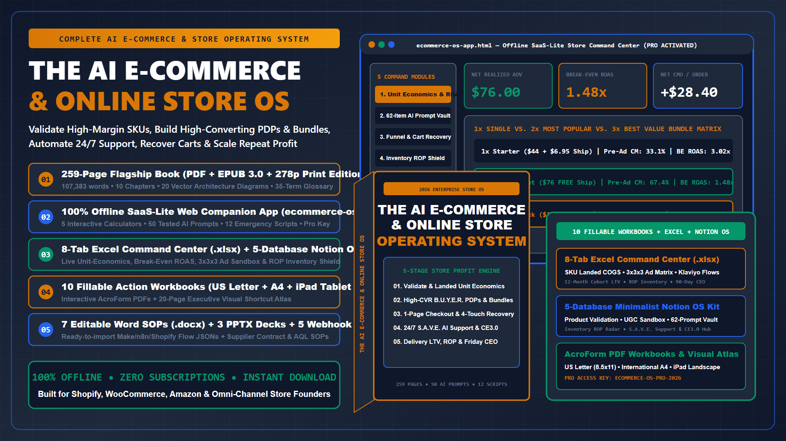
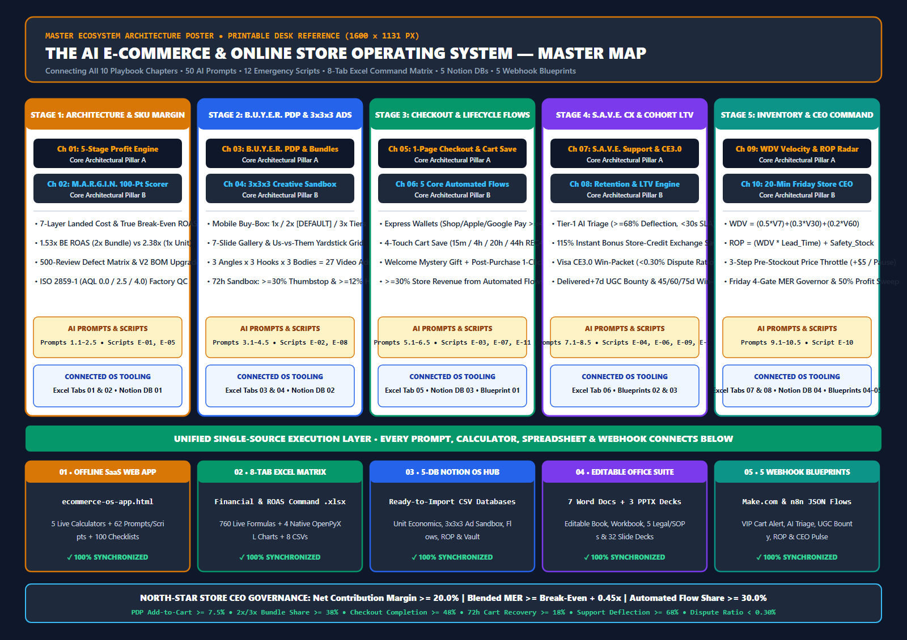

# The AI E-Commerce & Online Store Operating System — Official Live Showcase

Welcome to the official interactive web showcase and free diagnostic portal for **The AI E-Commerce & Online Store Operating System (2026 Flagship Edition)**.

---

## 🚀 Launch the Live Interactive Applications & Free Sample Kit

- 🌐 **[Open the Official Conversion Landing Page & Live Store Profit Simulator (`https://cryptxploit.github.io/AI-E-Commerce-Store-OS/`)](https://cryptxploit.github.io/AI-E-Commerce-Store-OS/)**
- ⚡ **[Launch the Interactive Web Companion App in Free Diagnostic Mode (`app.html`)](https://cryptxploit.github.io/AI-E-Commerce-Store-OS/app.html)**
- 🎨 **[Launch the Interactive Cover & Promo Banner Customizer Studio (`studio.html`)](https://cryptxploit.github.io/AI-E-Commerce-Store-OS/studio.html)**
- 📄 **[Download Free 34-Page Sample Chapter 1 & 7-Day Store Margin Audit (`.PDF`)](https://cryptxploit.github.io/AI-E-Commerce-Store-OS/assets/tier0-free-sample-chapter01-and-audit.pdf)**
- 📝 **[Download Free 6-Page Fillable Chapter 1 Action Worksheet (`.PDF`)](https://cryptxploit.github.io/AI-E-Commerce-Store-OS/assets/chapter-01-workbook.pdf)**
- 📦 **[Download Complete 9-File Free Starter Audit Kit (`.ZIP`)](https://cryptxploit.github.io/AI-E-Commerce-Store-OS/assets/Tier0-Free-Store-Margin-and-Cart-Audit-Kit.zip)**

---

## 🗺️ The 5-Stage Store Profit Engine Architecture

1. **Stage 01 — Validate & Lock In SKU Unit Economics (`M.A.R.G.I.N.`):** Audit all 7 variable cost layers, compute true Pre-Ad Contribution Margin and Break-Even ROAS, and engineer Version 2.0 (`V2`) product upgrades under ISO 2859-1 (`AQL 2.5`) quality gates.
2. **Stage 02 — Convert & Bundle (`B.U.Y.E.R.` PDPs + `3x3x3` UGC Ads):** Deploy mobile-first buy-boxes with pre-selected `2x Most Popular` and `3x Best Value` bundle tiers and test 27 modular video ads per creator shoot inside a 72-hour sandbox.
3. **Stage 03 — Recover & Upsell (1-Page Express Checkout + 5 Automated Flows):** Combine biometric express wallets with a segmented 4-touch abandoned checkout sequence (`18%+` 72h recovery rate) and 5 behavior-triggered lifecycle flows generating `30%+` of total store revenue.
4. **Stage 04 — Fulfill & Defend (`S.A.V.E.` 24/7 AI Triage + Visa `CE3.0`):** Deflect `68%+` of routine WISMO support tickets in under 60 seconds, convert `42%+` of refund requests into `115%` bonus store-credit exchanges, and win friendly-fraud disputes.
5. **Stage 05 — Retain & Govern (Delivery-Anchored LTV + `ROP` Inventory Radar + Friday Store CEO):** Trigger `$15` video UGC bounties 7 days after verified carrier delivery, prevent Hero SKU stockouts with Recency-Weighted Daily Velocity (`WDV`), and govern the entire business in 20 minutes every Friday morning.

---

*© 2026 Digital Knowledge Product Studio. All Rights Reserved. Commercial Editions (Tiers 1–4) are licensed exclusively to verified purchasers.*
